# Habib Ullah Logistics — Fleet & HR Management System

Welcome to the **Habib Ullah Logistics Fleet & HR Management System**—a custom-built, modern enterprise enterprise resource planning (ERP) and operations dashboard designed specifically for Omani logistics operations. This system streamlines driver/employee tracking, fleet maintenance, dispatch logs, fuel monitoring, client billing with Omani VAT, ROP traffic violation tracking, and automated payroll calculations.

---

## 🏢 Brand & Company Identity

- **Company Name:** Habib Ullah Logistics LLC
- **Location:** Muscat, Sultanate of Oman
- **System Initials / Badge:** `HU` (representing **H**abib **U**llah Logistics)

---

## 🖥️ Screen Showcases

### 🔑 Authentication / Login
Secure portal for dispatchers and administrators to access the logistics dashboard.
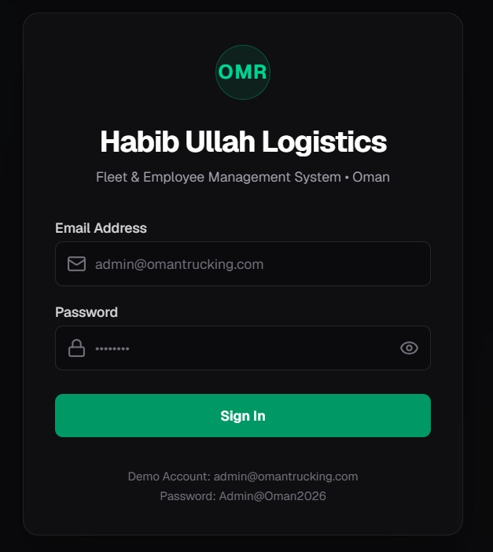

### 📊 Main Dashboard & Fleet Overview
Real-time operations command center showing KPI counters, Month-to-Date (MTD) financial summaries, and a critical Document Expiry warning engine (Visas, Passports, Driving Licenses, and Mulkiyas).
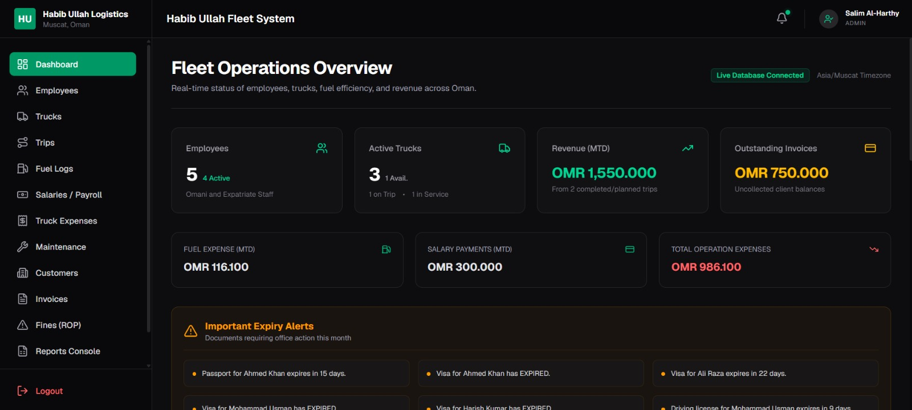

### 👥 Employee Profile & Onboarding
Complete HR records containing contact details, passport/visa compliance records, and driving license tracking to keep logistics compliant with Omani labor laws.
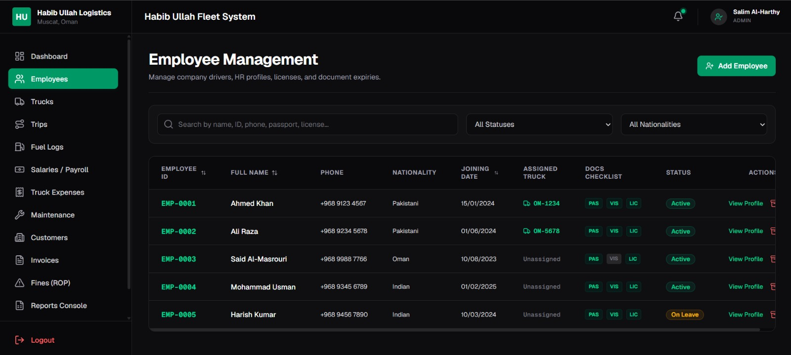

### 🚛 Fleet & Vehicle Registry (Mulkiya)
Manage license plates, chassis numbers, assignments, and Omani Mulkiya/insurance policy expiry alerts.
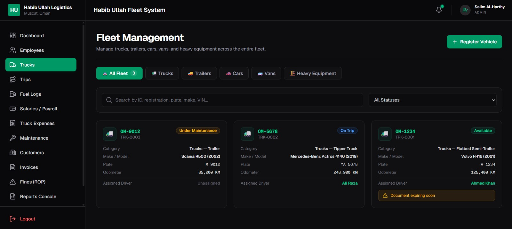

### 🗺️ Logistics Dispatch & Trip Logs
Dispatches trucks to clients, tracks cargo details, and automatically logs starting/ending odometer readings to calculate fuel efficiency and distance.
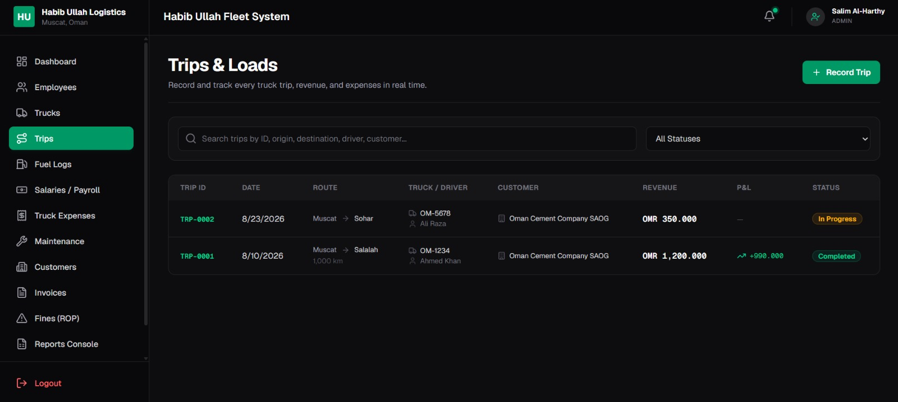

### ⛽ Smart Fuel Logger
Logs fuel refills, fuel cards, station names, liters, and cost. Automatically computes total expenses and updates truck odometer levels.
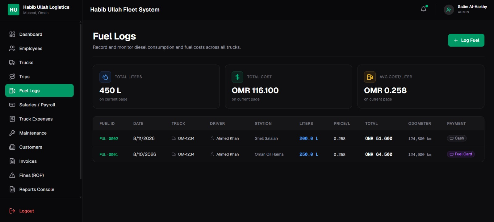

### 💳 Payroll & Salaries Console
Combines base salaries and custom monthly allowances (housing, utility, food) while automatically deducting employee advances and logged traffic fines for clean pay slips.
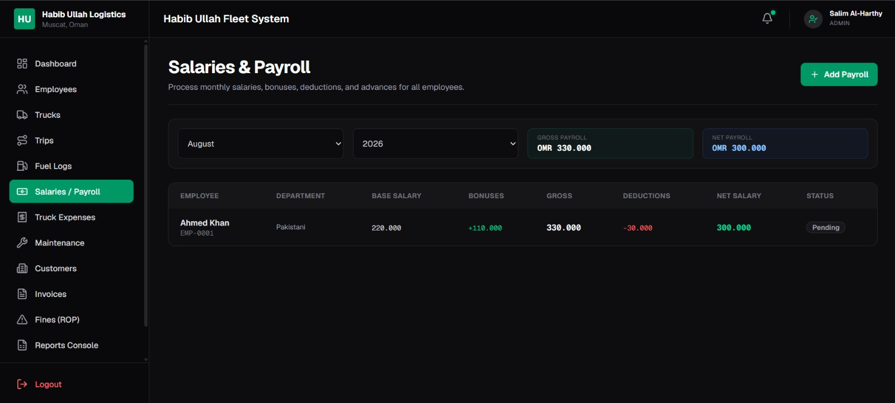

### 💸 Operating Expenses Tracker
Categorized logging of office overheads, miscellaneous repairs, and admin expenditures to track company cash flow.
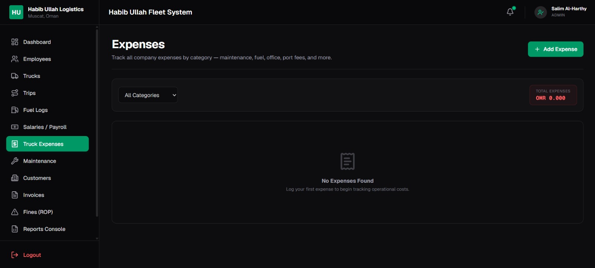

### 🔧 Workshop & Maintenance Logs
Logs preventative maintenance and parts repair histories, flagging maintenance costs against specific trucks.
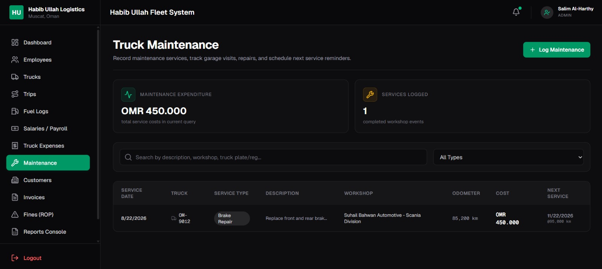

### 🤝 Customer & Client Directory
Client database containing specific details, contact information, and Omani Rial credit limits to prevent dispatching to overdue accounts.
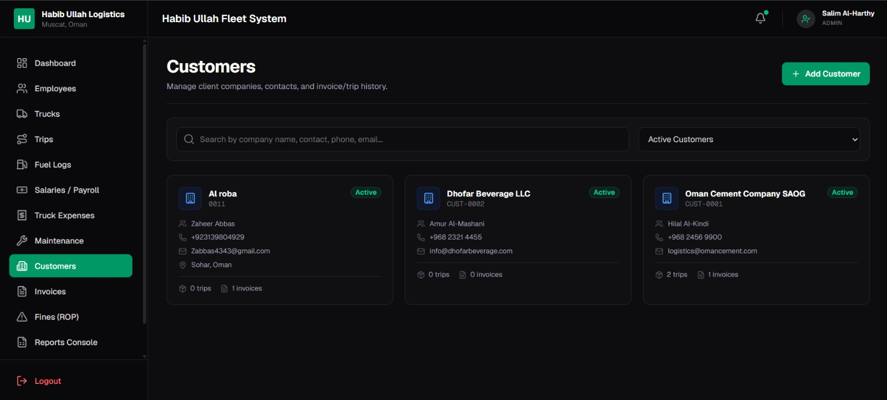

### 📄 Billing & Client Invoicing
Invoices automatically calculate the standard 5% Omani VAT. Tracks payment lifecycle statuses (Draft, Sent, Partially Paid, Paid, Overdue).
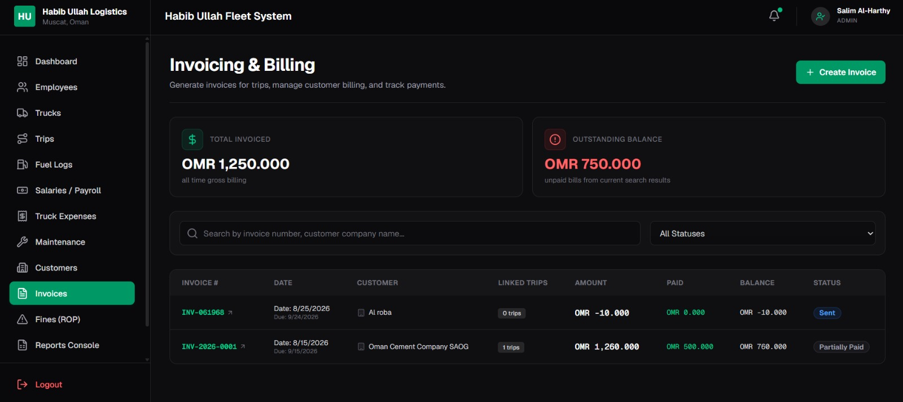

### 🚨 Royal Oman Police (ROP) Fines
Log traffic safety violations against drivers/trucks with automatic payroll deduction routing.
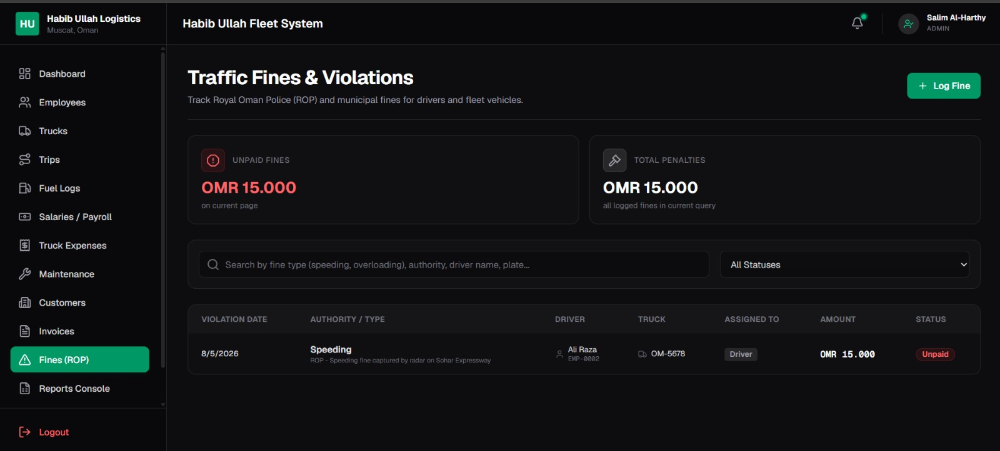

### 📈 Reports Console
Generates CSV/Excel formats of operational, payroll, and invoice data for accounting audits.
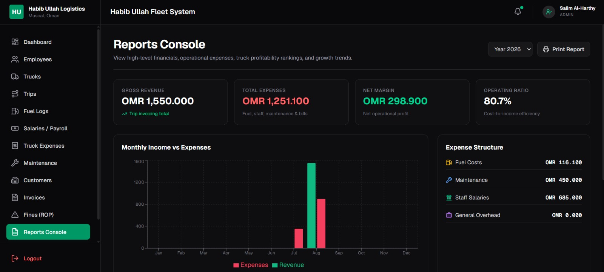

### ⚙️ System Settings
Configurable system parameters, warning thresholds (such as document expiry warnings), and system constants.
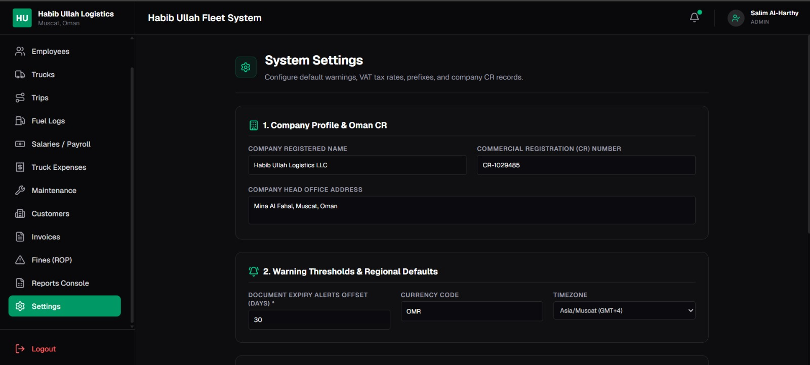

---

## 🛠️ Architecture & Tech Stack

- **Framework:** Next.js (App Router)
- **Styling:** Tailwind CSS (Dark Mode Slate/Zinc Premium UI)
- **Database ORM:** Prisma Client v7
- **Database Engine:** MySQL / MariaDB
- **Data Visualization:** Recharts
- **Icons:** Lucide React

---

## 🚀 Quick Start (First Time Setup)

To run the application locally on your machine, follow these steps in your terminal at `d:\Mazharhabib\logistics`:

### 1. Install Dependencies
```bash
npm install
```

### 2. Configure Environment
Copy `.env.example` to `.env` (it has already been done for you) and ensure the MySQL connection URL is correct:
```env
DATABASE_URL="mysql://root@localhost:3306/logistics"
AUTH_SECRET="oman_trucking_secret_2026_super_secure_key_123456"
```

### 3. Setup Database Schema and Migrations
Sync the database with the Prisma schema:
```bash
npx prisma migrate dev --name init
```

### 4. Seed the Database
Populate the database with realistic mock Omani logistics data (including settings, drivers, trucks, trips, customers, and active alerts):
```bash
npx prisma db seed
```

### 5. Launch the Development Server
```bash
npm run dev
```
Open **[http://localhost:3000](http://localhost:3000)** in your browser.

---

## 🔐 Seeded Credentials (Demo Account)

*   **Email:** `admin@omantrucking.com`
*   **Password:** `Admin@Oman2026`
